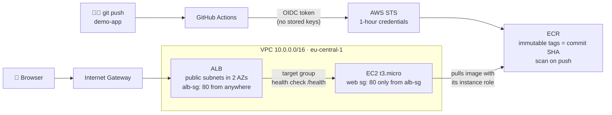

# aws-platform

> 🚧 **Work in progress.** Rebuilding my [homelab-k8s](https://github.com/umuttvar/homelab-k8s) platform on AWS, with Terraform and without long-lived credentials.

🏠 Previous project: [umuttvar/homelab-k8s](https://github.com/umuttvar/homelab-k8s) · 🐍 Application repo: [umuttvar/demo-app](https://github.com/umuttvar/demo-app)

**TL;DR:** The same FastAPI app as in my homelab, now on AWS:
`git push` → GitHub Actions → **OIDC** (no access keys) → ECR (scan on push) → EC2 behind an ALB.
Every resource is defined in Terraform. Compute is destroyed after every session to keep the bill near zero.

---

## How it works



The EC2 instance has a public IP but **can't be reached directly**: its security group only accepts traffic whose source is the ALB's security group.

---

## Highlights

- **No long-lived credentials anywhere**
  - GitHub Actions assumes an IAM role through **OIDC**. The trust policy only accepts tokens from `demo-app`'s `main` branch.
  - EC2 pulls from ECR with its **instance role**.
  - Humans log in with **IAM Identity Center (SSO)**. No access keys were created.
- **Security group referencing:** the app server only accepts traffic from the load balancer's SG, not from an IP range.
- **No SSH:** no key pair, no port 22. Shell access goes through **SSM Session Manager**.
- **Least privilege:** the CI role can push to one ECR repository and nothing else.
- **Remote state** in S3 with native locking (`use_lockfile`), one state file per layer.
- **Immutable image tags** (first 7 characters of the commit SHA), scanned by ECR on push.
- **Cost discipline:** network and registry are free or cost cents. Compute (EC2 + ALB) is created for a session and destroyed afterwards.

---

## Repository structure

Each folder is a separate Terraform root module with its own state, because each layer has a different lifetime:

```
aws-platform/
├── bootstrap/   # S3 bucket for remote state (local state, created once)
├── network/     # VPC, 2 public + 2 private subnets in 2 AZs, IGW, route tables     → stays
├── registry/    # ECR repository, GitHub OIDC provider, CI role                         → stays
└── compute/     # Security groups, EC2 (+ IAM role for SSM and ECR), ALB, target group  → destroyed after each session
```

Layers share data only through outputs: `compute` reads `network` and `registry` with `terraform_remote_state`.
Destroying compute can never touch the VPC or the image repository.

---

## Tech stack

| Area | Tool |
|---|---|
| IaC | Terraform 1.16, AWS provider 6.x |
| State | S3 (versioned, public access blocked) + native lock file |
| Network | VPC, 2 AZs, public / private subnets, IGW, route tables |
| Compute | EC2 (Amazon Linux 2023, `t3.micro`), cloud-init `user_data` |
| Load balancing | Application Load Balancer, target group with health checks |
| Access | IAM Identity Center (SSO), SSM Session Manager |
| Registry | ECR (immutable tags, scan on push) |
| CI | GitHub Actions + OIDC |

---

## Roadmap

- [x] AWS account hardening: root MFA, SSO user, budget alerts
- [x] Remote state bootstrap (S3 + locking)
- [x] Network layer: VPC across 2 AZs
- [x] EC2 running the app via `user_data`, shell access through SSM only
- [x] ALB + target group; EC2 reachable only through the ALB
- [x] ECR + GitHub Actions with OIDC
- [x] EC2 pulls the image from ECR with its instance role; image tag is a Terraform variable
- [ ] **EKS + Argo CD:** GitOps deploys, so a new image no longer needs a manual `apply`
- [ ] App servers in private subnets (NAT gateway or VPC endpoints)
- [ ] HTTPS with ACM
- [ ] ECR lifecycle policy (keep the last N images)
- [ ] Monitoring (CloudWatch / Prometheus)
- [ ] Terraform CI: `fmt`, `validate` and `plan` on every pull request

---

## Problems I hit (so far)

| Symptom | Root cause | Fix |
|---|---|---|
| ALB/EC2 returned `connection refused` | Container started with `-p 80:8080`, but the app listens on 8000. Found with `docker ps` over SSM | `-p 80:8000` in `user_data` |
| Fixed `user_data`, nothing changed on the instance | cloud-init runs `user_data` **only on first boot** | `user_data_replace_on_change = true` |
| Plan wanted to replace the instance for no visible reason | `data "aws_ami"` with `most_recent = true` picked up a newly released AL2023 image | Expected here; in production pin the AMI or `ignore_changes = [ami]` |
| SSM "Connect" button disabled | The instance profile was attached after boot; the SSM agent hadn't picked up credentials | Reboot. With the profile defined from the start it works on first boot |
| `RegisterTargets: Instance ID ... is not valid` | `target_id` pointed to the target group's ARN instead of the instance ID. `plan` only checks types, not meaning | `target_id = aws_instance.web.id` |
| Renaming the target group failed with `ResourceInUse` | Terraform destroys before it creates; the listener still pointed to the old group | `lifecycle { create_before_destroy = true }` |
| `MalformedPolicyDocument: valid version string` | Wrong `Version` value in the IAM policy | `Version = "2012-10-17"`: the only accepted value |
| `jsondecode` error in the trust policy | Used `jsondecode` instead of `jsonencode` | `jsonencode` turns HCL into the JSON string IAM expects |
| Actions: "Source Account ID is needed if the Role Name is provided" | The role ARN was stored in the GitHub variable **with quotes** copied from `terraform output` | `terraform output -raw` |
| Actions: `Not authorized to perform sts:AssumeRoleWithWebIdentity` | GitHub's OIDC `sub` claim now contains immutable IDs: `repo:owner@<id>/repo@<id>:ref:...`. The commonly documented format without IDs didn't match | Decoded the token's claims in a temporary debug step, updated the trust policy with the exact value |
| `Error acquiring the state lock` (S3 412) | A previous interrupted `plan` left its lock file behind | Checked no Terraform process was running, then `terraform force-unlock <ID>` |

Lesson so far: **read the real value, don't trust the example.** The OIDC `sub` claim, the container port and the AMI ID
were all different from what I assumed, and each time the fix started with looking at what was actually there.

---

## Usage

```bash
# Once
cd bootstrap && terraform init && terraform apply

# Long-lived layers
cd ../network  && terraform init && terraform apply
cd ../registry && terraform init && terraform apply

# Per session
cd ../compute && terraform init
TAG=$(aws ecr describe-images --repository-name demo-app \
  --query 'sort_by(imageDetails,&imagePushedAt)[-1].imageTags[0]' --output text)
terraform apply -var="image_tag=$TAG"
terraform output alb_dns_name

# End of session
terraform destroy -var="image_tag=x"
```

Before the first CI run, add `AWS_ROLE_ARN` and `ECR_REPOSITORY_URL` as **repository variables** in `demo-app`
(values from `terraform -chdir=registry output -raw ...`).

---

> 🚧 **This project is in progress.** Next up: EKS + Argo CD, so that a push to `demo-app` is deployed automatically,
> the same way it works in my homelab. Screenshots will be added as the platform takes its final shape.
