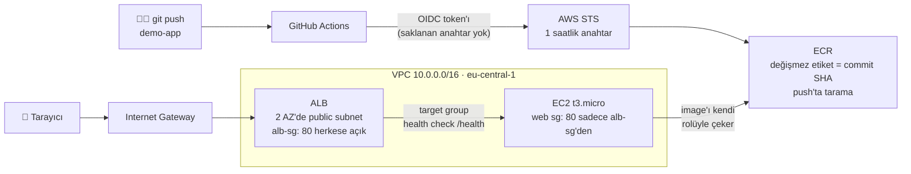

# aws-platform

> 🚧 **Devam eden proje.** [homelab-k8s](https://github.com/umuttvar/homelab-k8s) platformumu AWS üzerinde, Terraform ile ve kalıcı erişim anahtarı kullanmadan yeniden kuruyorum.

🇬🇧 [English README](README.md) · 🏠 Önceki proje: [umuttvar/homelab-k8s](https://github.com/umuttvar/homelab-k8s) · 🐍 Uygulama reposu: [umuttvar/demo-app](https://github.com/umuttvar/demo-app)

**Özetle:** Homelab'deki FastAPI uygulamasının aynısı, bu sefer AWS'de:
`git push` → GitHub Actions → **OIDC** (access key yok) → ECR (push'ta tarama) → ALB arkasında EC2.
Her kaynak Terraform'da tanımlı. Faturayı sıfıra yakın tutmak için compute katmanı her oturumun sonunda siliniyor.

---

## Nasıl çalışıyor?



EC2'nin public IP'si var ama ona **doğrudan ulaşılamıyor**: güvenlik grubu sadece kaynağı ALB'nin güvenlik grubu olan trafiği kabul ediyor.

---

## Öne çıkanlar

- **Hiçbir yerde kalıcı anahtar yok**
  - GitHub Actions, **OIDC** ile bir IAM rolü alıyor. Trust policy sadece `demo-app` reposunun `main` branch'inden gelen token'ları kabul ediyor.
  - EC2, ECR'dan **kendi instance rolüyle** image çekiyor.
  - İnsanlar **IAM Identity Center (SSO)** ile giriş yapıyor. Hiç access key oluşturulmadı.
- **Güvenlik grubu referansı:** uygulama sunucusu IP aralığına göre değil, sadece load balancer'ın SG'sinden gelen trafiği kabul ediyor.
- **SSH yok:** key pair yok, 22 portu kapalı. Sunucuya **SSM Session Manager** ile bağlanılıyor.
- **En az yetki:** CI rolü sadece tek bir ECR deposuna push yapabiliyor, başka hiçbir şeye dokunamıyor.
- **Uzak state:** S3'te, yerleşik kilitleme ile (`use_lockfile`), her katmanın ayrı bir state dosyası var.
- **Değişmez image etiketleri:** commit SHA'nın ilk 7 karakteri. ECR her push'ta tarıyor.
- **Maliyet disiplini:** network ve registry ücretsiz ya da kuruşluk. Compute (EC2 + ALB) oturum için kuruluyor, oturum sonunda siliniyor.

---

## Repo yapısı

Her klasör kendi state'i olan ayrı bir Terraform projesi, çünkü her katmanın ömrü farklı:

```
aws-platform/
├── bootstrap/   # Uzak state için S3 bucket'ı (yerel state, bir kere kuruldu)
├── network/     # VPC, 2 AZ'de 2 public + 2 private subnet, IGW, route table'lar     → kalıcı
├── registry/    # ECR deposu, GitHub OIDC provider, CI rolü                           → kalıcı
└── compute/     # Güvenlik grupları, EC2 (+ SSM ve ECR için IAM rolü), ALB, target group → her oturum sonunda silinir
```

Katmanlar birbirleriyle sadece output'lar üzerinden konuşuyor: `compute`, `network` ve `registry`'yi `terraform_remote_state` ile okuyor.
Compute'u silmek VPC'ye ya da image deposuna asla dokunamaz.

---

## Kullanılan teknolojiler

| Alan | Araç |
|---|---|
| Kod olarak altyapı | Terraform 1.16, AWS provider 6.x |
| State | S3 (versiyonlu, public erişim kapalı) + yerleşik kilit dosyası |
| Ağ | VPC, 2 AZ, public / private subnet'ler, IGW, route table'lar |
| Sunucu | EC2 (Amazon Linux 2023, `t3.micro`), cloud-init `user_data` |
| Yük dengeleme | Application Load Balancer, health check'li target group |
| Erişim | IAM Identity Center (SSO), SSM Session Manager |
| Registry | ECR (değişmez etiketler, push'ta tarama) |
| CI | GitHub Actions + OIDC |

---

## Yol haritası

- [x] AWS hesabını güvenli hale getirme: root MFA, SSO kullanıcısı, bütçe uyarıları
- [x] Uzak state kurulumu (S3 + kilitleme)
- [x] Ağ katmanı: 2 AZ'ye yayılan VPC
- [x] `user_data` ile uygulamayı çalıştıran EC2, erişim sadece SSM ile
- [x] ALB + target group; EC2'ye sadece ALB üzerinden ulaşılabiliyor
- [x] ECR + OIDC ile GitHub Actions
- [x] EC2 image'ı ECR'dan kendi rolüyle çekiyor; image etiketi Terraform değişkeni
- [ ] **EKS + Argo CD:** GitOps ile deploy, yeni bir image için elle `apply` gerekmesin
- [ ] Uygulama sunucularını private subnet'lere taşımak (NAT gateway ya da VPC endpoint'leri)
- [ ] ACM ile HTTPS
- [ ] ECR lifecycle policy (son N image'ı tut)
- [ ] İzleme (CloudWatch / Prometheus)
- [ ] Terraform CI: her pull request'te `fmt`, `validate` ve `plan`

---

## Karşılaştığım sorunlar (şimdiye kadar)

| Belirti | Kök neden | Çözüm |
|---|---|---|
| ALB/EC2 `connection refused` döndü | Container `-p 80:8080` ile başlatılmış, ama uygulama 8000'i dinliyor. SSM üzerinden `docker ps` ile bulundu | `user_data`'da `-p 80:8000` |
| `user_data` düzeltildi ama sunucuda hiçbir şey değişmedi | cloud-init `user_data`'yı **sadece ilk açılışta** çalıştırır | `user_data_replace_on_change = true` |
| Plan, görünür bir sebep olmadan sunucuyu yenilemek istedi | `most_recent = true` olan `data "aws_ami"` yeni çıkan bir AL2023 imajını aldı | Burada beklenen davranış; production'da AMI sabitlenir ya da `ignore_changes = [ami]` |
| SSM "Connect" butonu pasif | Instance profile sunucu açıldıktan sonra eklenmişti; SSM agent'ı yetkiyi henüz almamıştı | Yeniden başlatma. Profil baştan tanımlı olunca ilk açılışta çalışıyor |
| `RegisterTargets: Instance ID ... is not valid` | `target_id`, instance ID yerine target group'un ARN'ini gösteriyordu. `plan` sadece tipleri kontrol eder, anlamı değil | `target_id = aws_instance.web.id` |
| Target group'un adını değiştirmek `ResourceInUse` ile başarısız oldu | Terraform önce siler sonra kurar; listener hâlâ eski gruba bağlıydı | `lifecycle { create_before_destroy = true }` |
| `MalformedPolicyDocument: valid version string` | IAM policy'de yanlış `Version` değeri | `Version = "2012-10-17"`: kabul edilen tek değer |
| Trust policy'de `jsondecode` hatası | `jsonencode` yerine `jsondecode` yazılmış | `jsonencode`, HCL'i IAM'in beklediği JSON metnine çevirir |
| Actions: "Source Account ID is needed if the Role Name is provided" | Rol ARN'i GitHub değişkenine `terraform output`'tan **tırnaklarıyla** kopyalanmıştı | `terraform output -raw` |
| Actions: `Not authorized to perform sts:AssumeRoleWithWebIdentity` | GitHub'ın OIDC `sub` claim'i artık değişmez ID'ler içeriyor: `repo:owner@<id>/repo@<id>:ref:...`. Dokümanlarda sık geçen ID'siz format eşleşmedi | Geçici bir debug adımında token'ın içeriği çözüldü, trust policy birebir o değerle güncellendi |
| `Error acquiring the state lock` (S3 412) | Yarıda kesilen bir `plan` kilit dosyasını geride bırakmıştı | Çalışan bir Terraform işlemi olmadığı kontrol edildi, sonra `terraform force-unlock <ID>` |

Şimdiye kadarki ders: **örneğe değil, gerçek değere bak.** OIDC `sub` claim'i, container portu ve AMI ID'si
varsaydığımdan farklı çıktı. Her seferinde çözüm, gerçekte ne olduğuna bakmakla başladı.

---

## Kullanım

```bash
# Bir kere
cd bootstrap && terraform init && terraform apply

# Kalıcı katmanlar
cd ../network  && terraform init && terraform apply
cd ../registry && terraform init && terraform apply

# Her oturumda
cd ../compute && terraform init
TAG=$(aws ecr describe-images --repository-name demo-app \
  --query 'sort_by(imageDetails,&imagePushedAt)[-1].imageTags[0]' --output text)
terraform apply -var="image_tag=$TAG"
terraform output alb_dns_name

# Oturum sonunda
terraform destroy -var="image_tag=x"
```

İlk CI çalışmasından önce `demo-app` reposuna `AWS_ROLE_ARN` ve `ECR_REPOSITORY_URL` değerlerini **repository variable** olarak ekle
(değerler: `terraform -chdir=registry output -raw ...`).

---

> 🚧 **Bu proje devam ediyor.** Sıradaki adım EKS + Argo CD: `demo-app`'e yapılan bir push, homelab'deki gibi
> otomatik olarak deploy edilecek. Ekran görüntüleri platform son haline geldikçe eklenecek.
